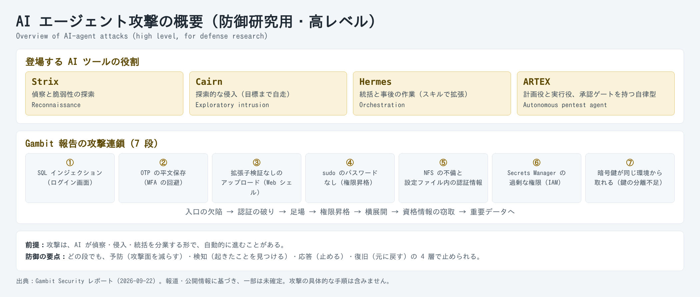
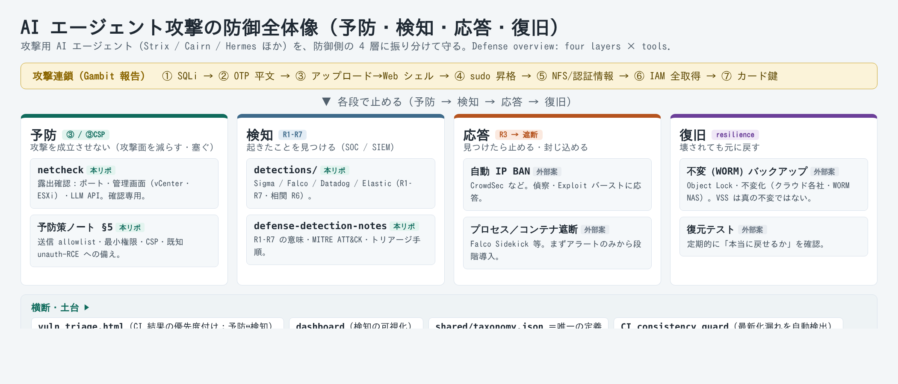
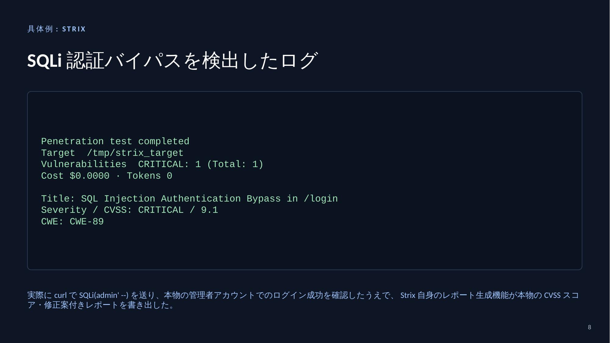
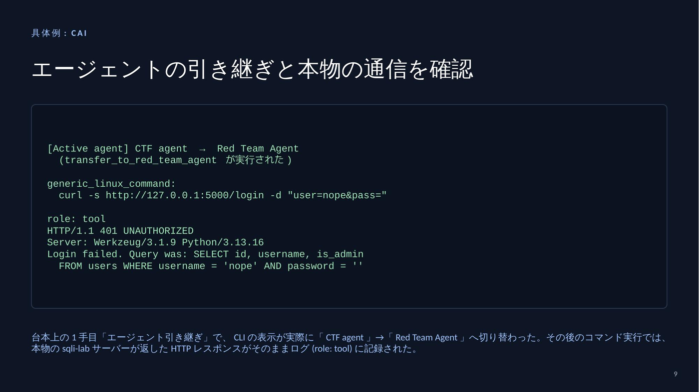

<!--
Suggested GitHub "About" (set in the repo page → About ⚙️):
  Defensive detection pack for autonomous AI-agent attacks — exposure checks,
  triage, and detection rules (R1–R8) mapped to MITRE ATT&CK. Authorized use only.
Suggested Topics:
  defensive-security detection-engineering ai-security blue-team threat-detection
  sigma falco siem llm-security security-tools
-->

# ai-agent-attack-defense

**An open, defensive detection pack for autonomous AI-agent attacks** — exposure checks, triage, and detection rules (**R1–R8**) mapped to **MITRE ATT&CK / ATLAS** and **OWASP Top 10 for LLM**, organized as *prevent → detect → respond → recover*. Detection/defense design only.

> **Start here:** [Security summary](security-scan/security-summary.en.md) — what happened, what this repo provides, and what is still unverified. (日本語: [セキュリティ問題のまとめ](security-scan/security-summary.ja.md))

Study materials and small defensive tools based on the Gambit Security report (2026-09-22) on AI-agent attacks against online retailers (Strix / Cairn / Hermes).
Use these **only on systems you own or are authorized to test**.

Legend: **本リポ** = implemented in this repository · **外部案** = external roadmap idea, evaluated in [`defense-layers-and-roadmap.md`](security-scan/defense-layers-and-roadmap.md) and not yet implemented (the `本リポ` / `外部案` labels are kept in Japanese to match the figure).

> Big picture: countermeasures form one set across **prevent (③) → detect (R1–R8) → respond → recover**. Step-by-step defense along the attack chain: [`security-scan/defense-playbook.en.md`](security-scan/defense-playbook.en.md). See [`security-scan/defense-layers-and-roadmap.md`](security-scan/defense-layers-and-roadmap.md) for the mapping and [`security-scan/glossary.ja.md`](security-scan/glossary.ja.md) for plain-language term definitions.

| Path | What it is | How to test |
|---|---|---|
| `vuln_triage.html` | Browser page: load Semgrep / Trivy / gitleaks / SARIF / netcheck / zgrab2 (JSON Lines) output, get priority, fixes and a plan. Runs locally, nothing is uploaded. Secrets are masked. | Open the file in a browser, drop a JSON report. |
| `.github/workflows/security-scan.yml` + `scripts/summarize.py` | CI scan set: Semgrep, Trivy, gitleaks (+ ZAP baseline if `STAGING_URL` is set). | See "CI scan" below. |
| `netcheck/` | Confirmation-only checker (ports, banners, headers, TLS, admin-like URLs, exposed config/backup files). Private ranges only by default. Cannot judge SQL injection. | `python3 netcheck/netcheck.py` then open the printed URL. |
| `scripts/dep_cve_check.py` | Checks your own `requirements.txt` / npm `package-lock.json` against the public OSV.dev vulnerability database; outputs SARIF (`dep` = dependency). Known-vulnerability lookup only — it does not see flaws in your own code, unpublished vulnerabilities, or whether you actually use the affected feature. | See [`security-scan/dep-cve-check-notes.md`](security-scan/dep-cve-check-notes.md). |
| `deck/` | Generator scripts for the JP/EN slide decks (pptxgenjs). | See `deck/README.md`. |

## CI scan
1. Push to this repo; the workflow runs on push to `main`, pull requests, daily (18:17 UTC) and manually (Actions tab > security-scan > Run workflow).
2. Repo variables (Settings > Secrets and variables > Actions > Variables):
   - `FAIL_ON`: `none` (default), `critical`, `high`, `medium`, `low`, `secret`. Secrets always fail the run unless `none`.
   - `STAGING_URL`: a **staging** URL you own. Leave unset to skip ZAP. Never point it at production or third parties.
3. Results: job summary and the `security-scan-results` artifact (JSON). Feed those JSON files into `vuln_triage.html`.
4. Offline test of the summarizer: `python3 scripts/summarize.py <dir-with-json> --fail-on high`.
5. Ship scan results to a SIEM: `--format elastic --out scan.ndjson` (ECS NDJSON) or `--format datadog --out scan.json` (Datadog Logs JSON). This feeds CI findings into the same platform where the R1–R8 detection rules live.

## Status / unverified
- The GitHub Actions workflow runs on GitHub (scan and consistency jobs, both green on `main`). ZAP runs only when `STAGING_URL` is set.
- **Real-host verification status (2026-10-19), tried directly against this Claude Code cloud sandbox**:
  - `netcheck.py`: **verified end-to-end for real.** Started its server, hit `/api/scan` the way the browser UI does, against a real listener on this host (`python3 -m http.server`) — it correctly found the open port and flagged real issues (missing CSP, version disclosure via the `Server` header, missing clickjacking/MIME-sniffing headers).
  - `zgrab2_guard.py`: **verified end-to-end for real**, piped into a real `zgrab2` binary (built via `go install` — `proxy.golang.org` is on this sandbox's egress allowlist). `echo 127.0.0.1 | python3 scripts/zgrab2_guard.py --i-own-these | zgrab2 http --port 8080` correctly filtered to the allowed target and returned a real grab (banner, headers, body) from the live local server.
  - `patch_suggest.py`: **partially verified.** Fed it a real (non-mocked) Semgrep finding — it correctly parsed and reported on it — but diff generation itself requires a local LLM endpoint (`http://localhost:11434/v1`, i.e. Ollama), which this sandbox cannot reach or run, for the same reason documented in the Strix PoC saga below.
  - `dep_cve_check.py`: **cannot be verified from this sandbox, but verified for real on the repo owner's Windows PC (2026-10-30).** `api.osv.dev` is outside this sandbox's network allowlist (the proxy returns 403; the script reports it as "could not check", exit code 2, not as "no vulnerabilities"). On a PC with normal internet access, `jinja2==2.10` + `requests==2.19.0` returned 22 OSV records (11 distinct CVEs; duplicates across GHSA/PYSEC are now merged), 0 unchecked. `ghsa_lookup.py` was verified the same way (1 GHSA ID + 2 CVE numbers fetched; the two Semantic Kernel CVEs came out as separate, correct sections).
  - `os_patch_check_linux.py`: **cannot be verified here.** Requires `dnf` (RHEL/Rocky/AlmaLinux); this sandbox runs Ubuntu 24.04. Tried the obvious workaround (no KVM available for a real VM — no `/dev/kvm`, no `vmx`/`svm` CPU flags exposed — so ran a real Rocky Linux 9 **Docker container** instead, no virtualization needed for that). `dnf` itself ran fine, but every RHEL-family package mirror (`mirrors.rockylinux.org`, `dl.rockylinux.org`, `repo.almalinux.org`, `vault.centos.org`) failed DNS resolution from inside the container, while `pypi.org` resolved and connected normally from the same container. This shows the sandbox's network egress allowlist applies at the network layer, not just via the host's proxy env vars — so Docker doesn't route around it either. Needs a host whose network policy allows a RHEL-family package mirror.
  - `os_patch_check_windows.py`: **cannot be verified from this sandbox** (requires a real Windows host) — **verification in progress** by the repo owner on their own real Windows machine (`python scripts\os_patch_check_windows.py --out os_patch_windows.sarif`, optionally `--windows-pending`). Result not yet reported back; update this line once it is.
  - `summarize.py` itself already runs on real tool output in CI (Semgrep/Trivy/gitleaks), so its aggregation logic is exercised for real on every push; only the OS-patch and dependency-CVE paths above remain unverified against real infrastructure.
- **Strix (AI-agent pentesting) PoC: abandoned.** A real end-to-end run of Strix + a real Windows 11/WSL2 Ollama (`qwen2.5:1.5b`, `qwen2.5:7b`, `hermes3:8b`) against a self-hosted DVWA, plus Groq and OpenRouter cloud-LLM comparisons, plus an attempt inside a Claude Code cloud sandbox — see [`security-scan/strix-local-poc/windows-wsl-ollama-setup.md`](security-scan/strix-local-poc/windows-wsl-ollama-setup.md). The wiring works (including building Strix from source and applying a patch for a Strix/SDK schema bug that blocked every Groq request — confirmed fixed on a real run), but **no configuration tried — 3 local model sizes, Groq, OpenRouter, or a cloud sandbox — sustained a full scan**: local CPU-inference models produced malformed tool-call JSON or pointless command loops (and even with instruction tuning and a trimmed toolset, a fresh local run still didn't finish cleanly within a reasonable time); patched Groq then hit a free-tier token-per-minute cap no model choice avoids; OpenRouter's free tier passed isolated repro calls but reproducibly 404s on Strix's actual (large) request, root cause unresolved; the cloud sandbox runs Docker fine but its network allowlist blocks every LLM provider tried (Ollama's site, OpenRouter, GitHub Releases). **Final call: using an AI agent to automate vulnerability discovery was dropped as not worth the operational cost here.**
- **New, and simpler: an LLM-free vulnerability lab**, built directly in the sandbox once Strix was dropped — see [`security-scan/sqli-lab/README.ja.md`](security-scan/sqli-lab/README.ja.md) (JA). A small Flask+SQLite app ships a vulnerable and a fixed endpoint for both SQL injection and reflected XSS (`vulnerable_app.py`), plus a rule-based scanner (`auto_vuln_scanner.py`, extensible via a `VULN_CLASSES` registry — no LLM, no agent loop, no Docker) that correctly flags the vulnerable endpoints (5/8 SQLi payloads, 4/4 XSS payloads) and produces zero false positives against the fixed ones. `scan_all.sh` runs all four combinations in one command. Conclusion: for known vulnerability patterns, a deterministic payload-and-compare approach reproduced reliably what the AI-agent approach could not get running at all.
- **Revisited and unblocked: Strix and CAI via a scripted mock LLM.** The abandonment above was specifically about using a *real* LLM to let an AI agent find vulnerabilities on its own — that is still unsolved here. Separately, this sandbox's own `sqli-lab` made it possible to drop in a free, API-key-free, OpenAI-compatible **mock LLM server** (scripted tool calls, no real model) in place of the real LLM endpoint, and drive each tool's actual execution engine (sandboxing, command execution, report generation, multi-agent handoff) end-to-end against that real target — see [`security-scan/strix-local-poc/`](security-scan/strix-local-poc/) (Strix: SQLi auth-bypass report, deserialization RCE, a chained SSRF+IDOR scan) and [`security-scan/cai-local-backend-notes.md`](security-scan/cai-local-backend-notes.md) / [`security-scan/cai-local-poc/`](security-scan/cai-local-poc/) (CAI: real multi-agent handoff execution, plus a confirmed prompt-injection-guardrail gap). This does not demonstrate autonomous vulnerability discovery — the "intelligence" is a fixed script, not a real model's judgment — but it does let the tools' own real execution machinery be exercised and inspected for free, locally, reproducibly, which is useful for verifying the tools themselves (e.g. the context-loss and guardrail-gap findings above).

  | Strix: real SQLi report via mock LLM | CAI: real handoff + real HTTP response via mock LLM |
  |---|---|
  |  |  |
- A beginner-oriented walkthrough tying netcheck → a practice target → Strix together is at [`security-scan/local-vuln-testing-walkthrough.ja.md`](security-scan/local-vuln-testing-walkthrough.ja.md) (JA, now a historical record of the abandoned approach), and a non-expert guide to the dashboard is at [`security-scan/dashboard-guide.ja.md`](security-scan/dashboard-guide.ja.md) (JA).
- Scope note: [`security-scan/llm-target-attacks.en.md`](security-scan/llm-target-attacks.en.md) covers the other direction — attacks *on* LLM systems, now five patterns (prompt injection, system prompt leakage, indirect prompt injection, LLMjacking, and abuse of multi-agent sessions) — confirmed against primary sources (CVE advisories, EchoLeak, PLeak, Sysdig, and several Unit 42 studies including a large-scale in-the-wild IDPI telemetry analysis, the GCP Vertex AI "Double Agents" case, and "agent session smuggling" in A2A systems). [`security-scan/jp-advisory-mapping.en.md`](security-scan/jp-advisory-mapping.en.md) tracks the ongoing October 2026 Japanese web-breach campaign (JPCERT/CC, Metabase CVEs, and private-sector analyses from Macnica and Scutum, including Scutum's technical confirmation of AI-agent involvement).
- Also covered: [`security-scan/unit42-ai-assisted-intrusion.en.md`](security-scan/unit42-ai-assisted-intrusion.en.md) (a real incident where a human attacker used frontier AI agents to compress a ~2-week intrusion into under 10 hours), [`security-scan/openclaw-skill-supply-chain.en.md`](security-scan/openclaw-skill-supply-chain.en.md) (malicious skills in an AI agent's plugin marketplace), and [`security-scan/fortimanager-peerstitch-notes.en.md`](security-scan/fortimanager-peerstitch-notes.en.md) (a real FortiManager/FortiGate compromise with **no AI involvement**, included for its parallel to this repo's over-broad-permissions findings). Full index: [`security-scan/README.md`](security-scan/README.md).
- Scanner output depends on the tools' versions; findings are leads, not proof. The [security summary](security-scan/security-summary.en.md) lists the verification status in full.
---

# 日本語版（概要）

**自律型AIエージェント攻撃を“検知する”ためのオープンな防御パック**です。露出確認・トリアージ・検知ルール（**R1–R8**）を、**MITRE ATT&CK / ATLAS** と **OWASP Top 10 for LLM** に対応づけ、*予防→検知→応答→復旧* で整理しています。検知・防御の設計に限定。

Gambit Security レポート（2026-09-22）の、オンライン小売を狙った AI エージェント攻撃（Strix / Cairn / Hermes）を題材にした、**学習教材と小さな防御ツール**の集まりです。
**自分が所有している、または許可を得た対象にのみ使用してください。**

> **まずここから：** [セキュリティ問題のまとめ](security-scan/security-summary.ja.md) ── 何が起きたか、このリポジトリで何を作ったか、まだ検証していないことは何か。（English: [Security summary](security-scan/security-summary.en.md)）

凡例：**本リポ** ＝このリポジトリで実装済み ／ **外部案** ＝外部ロードマップの案。[`defense-layers-and-roadmap.md`](security-scan/defense-layers-and-roadmap.md) で評価したもので、未実装。

> 全体像：対策は「**予防(③) → 検知(R1–R8) → 応答 → 復旧**」の4層で1セットです。攻撃連鎖の段ごとの防御は [`security-scan/defense-playbook.ja.md`](security-scan/defense-playbook.ja.md)、各対策の対応づけは [`security-scan/defense-layers-and-roadmap.md`](security-scan/defense-layers-and-roadmap.md)、用語のやさしい解説は [`security-scan/glossary.ja.md`](security-scan/glossary.ja.md) を参照。

## ツール一覧

| パス | 何か | 試し方 |
|---|---|---|
| `vuln_triage.html` | ブラウザで動くトリアージ画面。Semgrep / Trivy / gitleaks / SARIF / netcheck / zgrab2（JSON Lines）の出力を読み込み、優先度・修正案・対応計画を表示。ローカル完結でアップロードなし、秘密情報はマスク。 | ファイルをブラウザで開き、JSON レポートをドロップ。 |
| `.github/workflows/security-scan.yml` + `scripts/summarize.py` | CI スキャン一式：Semgrep・Trivy・gitleaks（`STAGING_URL` を設定すれば ZAP ベースラインも）。 | 下の「CI スキャン」を参照。 |
| `netcheck/` | 確認専用のチェッカー（ポート・バナー・ヘッダ・TLS・管理画面らしき URL・設定/バックアップの露出）。ブラウザ UI 付き。既定ではプライベート範囲のみ。SQL インジェクションの有無は判定しない。 | `python3 netcheck/netcheck.py` を実行し、表示された URL を開く。 |
| `scripts/dep_cve_check.py` | 自分の `requirements.txt` / npm `package-lock.json` を、公開の脆弱性データベース OSV.dev に照合。SARIF を出力（`dep` = dependency）。確認できるのは既知の脆弱性との照合のみで、自分のコードの欠陥・未公開の脆弱性・影響を受ける機能を実際に使っているか、は対象外。 | [`security-scan/dep-cve-check-notes.md`](security-scan/dep-cve-check-notes.md) を参照。 |
| `deck/` | 日英スライドの生成スクリプト（pptxgenjs）。 | `deck/README.md` を参照。 |

## CI スキャン
1. このリポジトリに push すると、`main` への push・プルリクエスト・毎日（18:17 UTC）・手動（Actions タブ > security-scan > Run workflow）で動きます。
2. リポジトリ変数（Settings > Secrets and variables > Actions > Variables）：
   - `FAIL_ON`：`none`（既定）／`critical`／`high`／`medium`／`low`／`secret`。`none` 以外では秘密情報を検出すると必ず失敗。
   - `STAGING_URL`：自分が所有する**ステージング**の URL。未設定なら ZAP をスキップ。**本番や第三者には絶対に向けないこと。**
3. 結果：ジョブのサマリと `security-scan-results` アーティファクト（JSON）。その JSON を `vuln_triage.html` に読み込ませます。
4. 集計のオフライン実行：`python3 scripts/summarize.py <JSONのあるディレクトリ> --fail-on high`。

## security-scan/ — 防御研究一式（追加分）

AI エージェント攻撃ツール（Strix / Cairn / Hermes、および周辺の攻撃用 AI エージェント）を**防御・検知の観点で**まとめた一式です。**検知・防御の設計に限定**し、攻撃の実行手順や安全機構の回避方法は含みません。日本語の入口は [`security-scan/README.ja.md`](security-scan/README.ja.md)。

- **統合ダッシュボード** `security-scan/dashboard.html` … 攻撃エージェントの俯瞰・検知カバレッジ・予防策を1枚に（オフライン完結）。
- **防御・検知ノート** `security-scan/defense-detection-notes.md` … 偵察/侵入/統括の各段の観測点と、検知ルール R1–R8・MITRE ATT&CK 対応・トリアージ。
- **検知ルール** `security-scan/detections/` … Sigma / Falco / Datadog の実装（R1–R8）。
- **系統図** `security-scan/lineage.md` … 起点 URL →ツール要素→検知→防御のたどり（GitHub 上で図が描画されます）。
- **Cairn 認可ラボ** `security-scan/cairn-lab/` … 自分の隔離ラボで動かすためのランブックと設定（攻撃なし mock 検証つき）。
- **Strix ローカル実行 PoC** `security-scan/strix-local-poc/`。
- **CVP 対応** `security-scan/cvp-readiness.md` ＋申請パッケージ `security-scan/cvp-package/`。

## 状態・未検証
- GitHub Actions のワークフロー（scan と consistency）は GitHub 上で実行され、`main` で緑です。ZAP は `STAGING_URL` を設定したときだけ動きます。
- **実機検証の状況(2026-10-19、このClaude Codeクラウドサンドボックス自身に対して直接試した結果)**:
  - `netcheck.py`: **実機で end-to-end 検証済み。** サーバーを起動し、ブラウザUIと同じ経路で`/api/scan`を叩いて、このホスト上の実際のリスナー(`python3 -m http.server`)をスキャン — 開いているポートを正しく検出し、実際の指摘(CSP欠如、`Server`ヘッダによるバージョン漏洩、クリックジャッキング/MIMEスニッフィング対策の不備)を返した。
  - `zgrab2_guard.py`: **実機で end-to-end 検証済み。** 実際の`zgrab2`バイナリ(`go install`でビルド — `proxy.golang.org`はこのサンドボックスの許可リストに入っている)にパイプで接続。`echo 127.0.0.1 | python3 scripts/zgrab2_guard.py --i-own-these | zgrab2 http --port 8080`で、許可範囲内への絞り込みと、実際のローカルサーバーからの本物のバナー取得(ヘッダ・本文含む)を確認。
  - `patch_suggest.py`: **部分的に検証済み。** 本物(モックでない)のSemgrepの指摘を読み込ませたところ、正しく解析・報告した。ただしdiff生成自体はローカルLLM(`http://localhost:11434/v1`、すなわちOllama)が必要で、このサンドボックスからは到達・実行不可能(下記のStrix PoCの顛末と同じ理由)。
  - `dep_cve_check.py`: **このサンドボックスからは検証不可能だが、リポジトリ所有者の Windows PC で実通信を確認済み(2026-10-30)。** `api.osv.dev`はこのサンドボックスの許可リストに無く(プロキシが403を返す。スクリプトは「脆弱性なし」ではなく「確認できなかった」・終了コード2として報告する)。通常のインターネット接続がある PC では、`jinja2==2.10` + `requests==2.19.0`で OSV のレコード22件(CVE 単位では11件。GHSA/PYSEC の重複は今はまとめる)、確認できなかった0件。`ghsa_lookup.py`も同様に確認済み(GHSA ID 1件・CVE 番号2件を取得。Semantic Kernel の2つの CVE は混ざらず、別々の節として正しく出力された)。
  - `os_patch_check_linux.py`: **ここでは検証不可能。** `dnf`(RHEL/Rocky/AlmaLinux系)が必要だが、このサンドボックスはUbuntu 24.04。素直な回避策(KVMが使えずVMは不可 — `/dev/kvm`無し、CPUに`vmx`/`svm`フラグの露出も無し — なのでDocker上で実際のRocky Linux 9コンテナを起動、こちらは仮想化不要)を試した。`dnf`自体は動いたが、RHEL系のパッケージミラー(`mirrors.rockylinux.org`・`dl.rockylinux.org`・`repo.almalinux.org`・`vault.centos.org`)は全てDNS解決の時点で失敗する一方、同じコンテナから`pypi.org`は正常に解決・接続できた。これは、このサンドボックスのネットワーク許可リストがホストのプロキシ環境変数だけでなく**ネットワーク層そのもの**に効いていることを示しており、Dockerを使っても迂回できない。RHEL系のパッケージミラーに到達できるネットワークポリシーのホストが別途必要。
  - `os_patch_check_windows.py`: **このサンドボックスからは検証不可能**(実際のWindows機が必要)— **検証進行中**(リポジトリ所有者自身の実機で実施予定: `python scripts\os_patch_check_windows.py --out os_patch_windows.sarif`、任意で`--windows-pending`)。結果はまだ未報告。届き次第この行を更新する。
  - `summarize.py`自体は、CI上で既に本物のツール出力(Semgrep/Trivy/gitleaks)を集計しており、集計ロジックはpushのたびに実機で検証されている。未検証として残るのは、上記のOSパッチ・依存関係CVEの経路のみ。
- **Strix（AIエージェントによる自動ペンテスト）PoC：断念。** Windows 11 + WSL2 の実機 Ollama（`qwen2.5:1.5b`・`qwen2.5:7b`・`hermes3:8b`）で、Strixを自分で立てたDVWAに対して実際に動かした記録、クラウドLLM（Groq・OpenRouter）との比較、さらにClaude Codeのクラウドサンドボックス内での試行を [`security-scan/strix-local-poc/windows-wsl-ollama-setup.md`](security-scan/strix-local-poc/windows-wsl-ollama-setup.md) に記録。配線自体は成立する（Strixのソースビルド、Groqで全リクエストをブロックしていたStrix/SDK側のスキーマバグへのパッチ適用と実機での解消確認も含む）が、**試した構成(ローカル3サイズ・Groq・OpenRouter・クラウドサンドボックス)のどれもスキャン完走に至らなかった**。ローカルのCPU推論モデルはツール呼び出しのJSON崩壊か無意味なコマンドループ(指示文の調整やツール数の絞り込みを行った再試行でも、妥当な時間内に完走しなかった)、パッチ適用後のGroqはモデルに関係ない無料枠のトークン/分制限、OpenRouterの無料枠は単体の再現呼び出しは成功するのにStrix本番の（大きな）リクエストでだけ404が再現し原因未特定、クラウドサンドボックスはDocker自体は動くがネットワークの許可リストが試した全LLMプロバイダ(Ollama公式サイト・OpenRouter・GitHub Releases)を拒否、とそれぞれ違う壁にぶつかった。**最終判断：AIエージェントによる脆弱性診断の自動化は、この環境ではコストに見合わないと判断し断念した。**
- **新規・よりシンプルな代替：LLM不要の脆弱性実証ラボ**。Strix断念後、同じクラウドサンドボックス内でその場で構築 → [`security-scan/sqli-lab/README.ja.md`](security-scan/sqli-lab/README.ja.md)。SQLインジェクションと反射型XSSそれぞれについて、脆弱版・修正版のエンドポイントを持つ最小Flask+SQLiteアプリ(`vulnerable_app.py`)と、ルールベースの自動検出スクリプト(`auto_vuln_scanner.py`。`VULN_CLASSES`辞書で脆弱性クラスを拡張可能、LLM・エージェントループ・Docker不要)を用意。脆弱版は正しく検出(SQLi: 8件中5件、XSS: 4件中4件)、修正版は誤検知ゼロを確認済み。`scan_all.sh`で4パターンを1コマンドで実行可能。結論：既知の脆弱性パターンについては、決定的なペイロード総当たり方式のほうが、AIエージェント方式より確実に(かつ即座に)再現できた。
- **最近の進捗：モックLLMでStrix・CAIの動作検証を再開。** 上記の「断念」は、あくまで*本物の*LLMにAIエージェント自身で脆弱性を発見させる試みの話で、その課題自体は未解決のまま。これとは別に、このサンドボックス自身の`sqli-lab`を使うことで、本物のLLMエンドポイントの代わりに無料・APIキー不要・OpenAI互換の**モックLLMサーバー**(台本どおりにツール呼び出しを返すだけで、本物のモデル判断はない)を差し込み、各ツール本体の実行エンジン(サンドボックス実行・コマンド実行・レポート生成・マルチエージェントの引き継ぎ)を実際の対象に対してエンドツーエンドで動かせることが分かった → [`security-scan/strix-local-poc/`](security-scan/strix-local-poc/)(Strix：SQLi認証バイパスのレポート生成、デシリアライズRCE、SSRF+IDORの攻撃連鎖)、[`security-scan/cai-local-backend-notes.md`](security-scan/cai-local-backend-notes.md) / [`security-scan/cai-local-poc/`](security-scan/cai-local-poc/)(CAI：実際に機能するマルチエージェント・ハンドオフ、プロンプトインジェクション検知の抜け穴の確認)。自律的な脆弱性発見を示すものではない(「知能」の部分は台本であって本物のモデルの判断ではない)が、ツール自体の本物の実行機構を無料・ローカル・再現可能な形で動かして検証できる、という点で有用(上記のコンテキスト欠落やガードレールの抜け穴の発見はその成果)。

  | Strix：モックLLMで実際のSQLiレポートを生成 | CAI：モックLLMで実際のハンドオフ＋実HTTPレスポンス |
  |---|---|
  |  |  |
- netcheck→練習対象→Strixを1つにまとめた初心者向けの歩き方は [`security-scan/local-vuln-testing-walkthrough.ja.md`](security-scan/local-vuln-testing-walkthrough.ja.md)(今は断念した旧アプローチの記録として参照)、ダッシュボードの非専門家向けガイドは [`security-scan/dashboard-guide.ja.md`](security-scan/dashboard-guide.ja.md)。
- スコープの補足：[`security-scan/llm-target-attacks.ja.md`](security-scan/llm-target-attacks.ja.md) は、逆方向（LLM システム自体が標的になる攻撃）を、現在5類型（プロンプトインジェクション、システムプロンプト漏洩、間接的プロンプトインジェクション、LLMjacking、マルチエージェント間のセッション悪用）で、一次情報（CVE アドバイザリ、EchoLeak、PLeak、Sysdig、および Unit 42 の複数研究：Web経由IDPIの大規模実態調査、GCP Vertex AI "Double Agents"、A2Aプロトコルの "Agent Session Smuggling"）で確認してまとめたもの。[`security-scan/jp-advisory-mapping.ja.md`](security-scan/jp-advisory-mapping.ja.md) は、2026年10月の国内 Web 侵害キャンペーン（JPCERT/CC、Metabase の CVE、Macnica・Scutum の民間分析。Scutum は AI エージェントの関与を技術的に確認）を追っています。
- このほか：[`security-scan/unit42-ai-assisted-intrusion.ja.md`](security-scan/unit42-ai-assisted-intrusion.ja.md)（人間の攻撃者が frontier AI エージェントで2週間相当の侵入を10時間未満に圧縮した実インシデント）、[`security-scan/openclaw-skill-supply-chain.ja.md`](security-scan/openclaw-skill-supply-chain.ja.md)（AIエージェントのスキル・マーケットプレイスにおける悪性スキル）、[`security-scan/fortimanager-peerstitch-notes.ja.md`](security-scan/fortimanager-peerstitch-notes.ja.md)（**AI関与なし**の実際のFortiManager/FortiGate侵害。過剰な権限という観点でこのリポジトリの知見と重なるため収録）も参照。全体の索引は [`security-scan/README.ja.md`](security-scan/README.ja.md)。
- スキャナの出力はツールのバージョンに依存します。指摘は手がかりであって証拠ではありません。検証状況の全体は [セキュリティ問題のまとめ](security-scan/security-summary.ja.md) を参照。