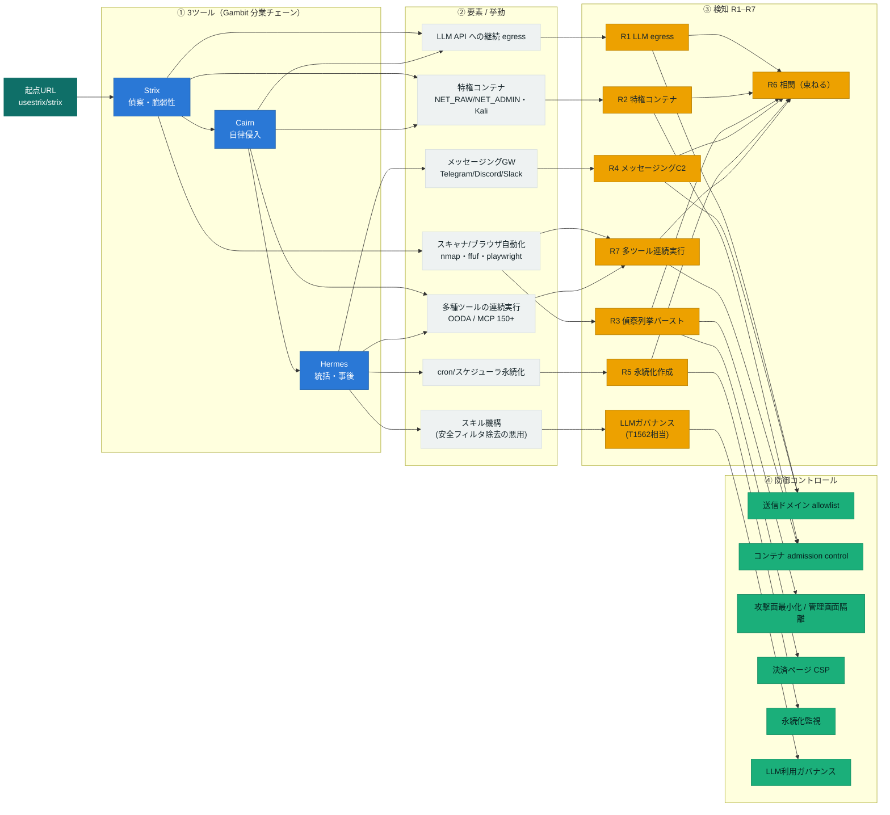
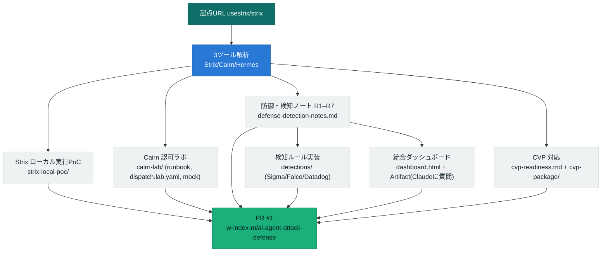
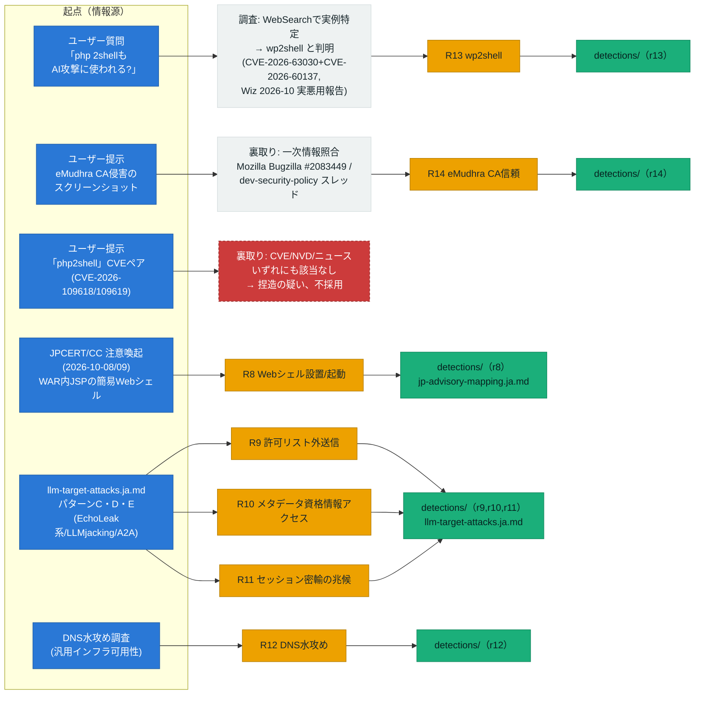

# 系統図 — URL からの派生（ツール要素 → 検知 → 防御）

起点は共有された **Strix の URL**。そこから 3 ツール（Strix/Cairn/Hermes）を読み込み、各ツールの
**要素/挙動**を**検知ルール R1–R7**と**防御コントロール**に結びつけた。本書はその派生をたどる系統図。
検知・防御の設計に限定。

起点: https://github.com/usestrix/strix
関連: [Cairn](https://github.com/oritera/Cairn) / [Hermes](https://github.com/NousResearch/hermes-agent)

## フロー図（ツール要素 → 検知 → 防御）

> 補足: ④E2E 自律型（PentAGI/Villager 等）・⑤攻撃基盤型（HexStrike 等）も同じ要素を持つため、
> 同じ検知（特に R7・R2・R1）が横展開で効く。ローカルLLM型は R1 を回避するため **R7/R2 に重心**。

## トレーサビリティ表（要素 → 検知 → 防御 → 成果物）

| ツール | 要素 / 挙動 | 検知 | 防御 | 本リポの成果物 |
|---|---|---|---|---|
| Strix | スキャナ/自動ブラウザ | R3, R7 | 攻撃面最小化, admission control | `detections/`（r3,r7）, `strix-local-*` |
| Strix | Docker サンドボックス | R2 | admission control | `strix-local-backend-notes.md` |
| Strix/Cairn/Hermes | LLM API egress | R1 | 送信ドメイン allowlist | `detections/`（r1）, `defense-detection-notes.md` |
| Cairn | 特権ワーカーコンテナ(NET_RAW) | R2 | admission control | `detections/`（r2, falco）, `cairn-lab/` |
| Cairn | OODA の多ツール実行 | R7 | admission control | `detections/`（r7）, `cairn-lab/`（mock検証） |
| Hermes | メッセージング GW | R4 | 送信ドメイン allowlist | `detections/`（r4） |
| Hermes | cron/永続化 | R5 | 永続化監視 | `detections/`（r5, falco） |
| Hermes | スキル（安全フィルタ除去の悪用） | ガバナンス(T1562) | LLM利用ガバナンス | `defense-detection-notes.md`（§6/注意） |
| 全体 | 連鎖（速く広い） | R6 相関 | SIEM 相関設計 | `defense-detection-notes.md`（R6）, `dashboard.html` |

## 成果物の系統（何がどこに結実したか）

## R8–R14 の系統（起点が異なる追加分）

R1–R7 は単一の起点 URL（Strix）から派生したが、R8 以降はそれぞれ**別々の起点**を持つ。
会話の中でユーザーが提示した断片情報（スクリーンショット・一言の質問）が、
**一次情報での裏取りを経て**検知ルールに結実したもの・**裏取りできず不採用になったもの**の両方を含む、
この系統図自体が「未検証の情報をどう扱うか」の記録でもある。

### トレーサビリティ表（R8–R14）

| 検知 | 起点 | 裏取り | 本リポの成果物 |
|---|---|---|---|
| R8 | JPCERT/CC 注意喚起（2026-10-08/09） | 原文確認済み | `detections/`（r8）, `jp-advisory-mapping.ja.md` |
| R9 | `llm-target-attacks.ja.md` パターンC（間接的プロンプトインジェクション） | EchoLeak(CVE-2025-32711)等、一次情報確認済み | `detections/`（r9） |
| R10 | 同パターンD（LLMjacking） | Sysdig 一次情報確認済み | `detections/`（r10） |
| R11 | 同パターンE（Agent Session Smuggling） | A2Aプロトコルの一次情報確認済み | `detections/`（r11） |
| R12 | DNS水攻め/ランダムサブドメイン攻撃の一般調査 | 攻撃手法として広く確立（AIエージェント特有ではない） | `detections/`（r12） |
| R13 | ユーザー質問「php 2shell」 | WebSearchで実例特定 → 実際は wp2shell（Wiz, 2026-10 実悪用報告） | `detections/`（r13） |
| R14 | ユーザー提示のeMudhra CA侵害スクリーンショット | Mozilla Bugzilla `#2083449` 等、一次情報で確認 | `detections/`（r14） |
| (不採用) | ユーザー提示の「php2shell」CVEペア（CVE-2026-109618/109619） | CVE/NVD/ニュースいずれにも該当なし → 捏造の疑いとして不採用 | なし（意図的に見送り） |

> この表の最終行が示す通り、ユーザーから提示された情報は**そのまま検知ルール化しない**。
> CVE番号の形式異常（2026年発行にしては桁数が不自然に多い）や、一次情報源（CVE.org/NVD/ベンダー公式）
> への不在を根拠に、採用前に必ず裏取りする運用をこのリポジトリでは徹底している。

---
検知・防御の設計に限定。攻撃の実行手順や安全機構の回避方法は含めない。
